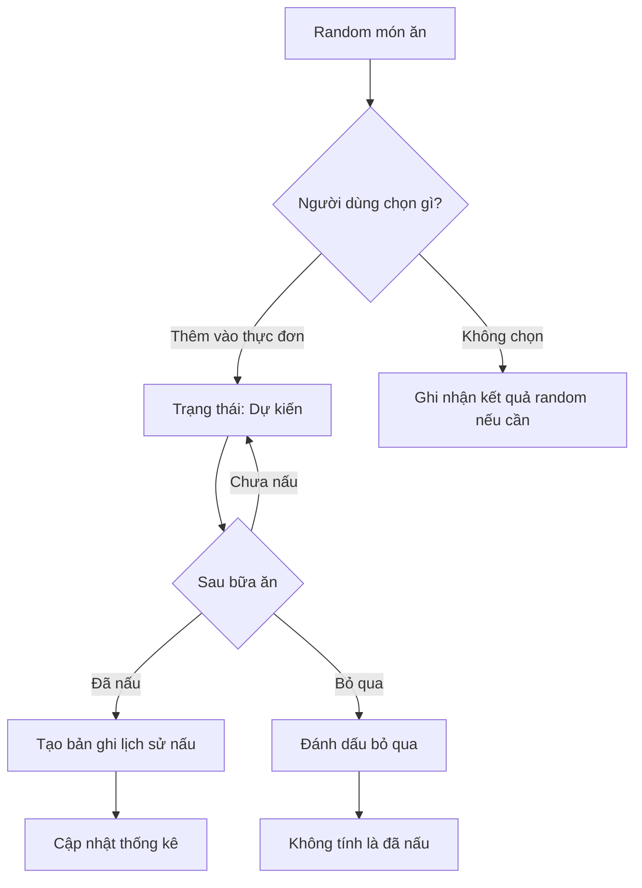

# Bep Nha

## Tech stack

- Frontend: React + TypeScript + Vite
- CSS: Tailwind CSS
- Backend: Node.js + Express
- Database: PostgreSQL

## Luong nghiep vu

## Danh sach API

| Method | Endpoint | Chức năng |
| --- | --- | --- |
| GET | /api/health | Kiểm tra server |
| GET | /api/dishes | Lấy danh sách món ăn |
| POST | /api/dishes | Thêm món ăn |
| PUT | /api/dishes/:id | Sửa món ăn |
| DELETE | /api/dishes/:id | Ngừng hiển thị món ăn |
| GET | /api/categories | Lấy danh mục món ăn |
