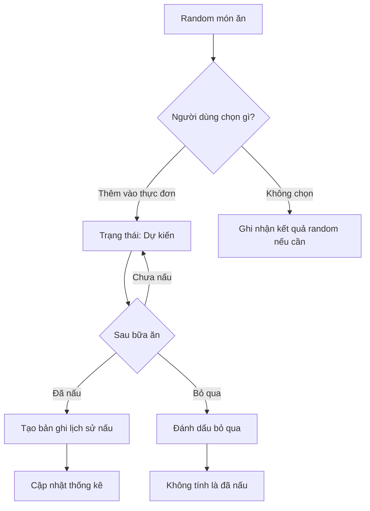

# Bep Nha

## Tech stack

- Frontend: React + TypeScript + Vite
- CSS: Tailwind CSS
- Backend: Node.js + Express
- Database: PostgreSQL

## Luong nghiep vu

## Nguyên tắc chọn món

- Hạn chế lặp món: giảm khả năng chọn những món đã nấu trong 3 ngày gần nhất.
- Cân bằng lịch sử: ưu tiên hợp lý các danh mục ít xuất hiện trong lịch sử nấu gần đây.
- Không tạo bữa thiếu thành phần: nếu chọn bữa cơm mà dữ liệu chưa đủ món chính, rau hoặc canh, hệ thống phải thông báo thiếu lựa chọn thay vì tự bịa món.
- Chỉ ghi lịch sử khi thực sự nấu: kết quả Random chưa phải bản ghi nấu ăn. Người dùng cần xác nhận đã nấu thì mới thêm vào thống kê.

### Lich su nau an

- Lịch tháng: hiển thị tên món trong từng ô ngày; nếu có nhiều món thì hiển thị một vài món và dòng +N món.

- Bấm vào một ngày: xem tất cả món đã nấu trong ngày đó.

- Danh sách bên dưới: hiển thị các ngày có nấu ăn, ngày mới nhất trước; không liệt kê những ngày trống.

- Chọn tháng khác: cả lịch và danh sách cùng thay đổi theo tháng đang xem.

- Thêm hoặc sửa lịch sử: cho phép chọn ngày thực tế đã nấu, kể cả khi xác nhận muộn.

## Danh sach API

| Method | Endpoint | Chức năng |
| --- | --- | --- |
| GET | /api/health | Kiểm tra server |
| GET | /api/dishes | Lấy danh sách món ăn |
| POST | /api/dishes | Thêm món ăn |
| PUT | /api/dishes/:id | Sửa món ăn |
| DELETE | /api/dishes/:id | Ngừng hiển thị món ăn |
| GET | /api/categories | Lấy danh mục món ăn |
| GET | /api/cooking-sessions/calendar?month=2026-10 | Lấy các món đã nấu trong tháng, không trùng món trong cùng ngày |
| GET | /api/cooking-sessions/by-date?date=2026-10-12 | Lấy từng lần nấu trong ngày, gồm giờ nấu và danh sách món |
| POST | /api/cooking-sessions | Ghi nhận một lần nấu |

### API tạo thực đơn

POST tạo menus từ random

- Nhận danh sách ID món từ chức năng random.
- Tạo dish_signature từ tập hợp ID đã chuẩn hóa.
- Nếu chữ ký đã tồn tại, trả về thực đơn cũ như hiện tại.
- Không nhất thiết phải có tên do người dùng đặt.

POST /api/menus

- Nhận tên thực đơn và danh sách ID món.
- Tạo một thực đơn mới, kể cả khi danh sách món trùng thực đơn khác.
- Không dùng dish_signature để tái sử dụng thực đơn.
- Có thể sửa tên, thêm hoặc bỏ món về sau.
